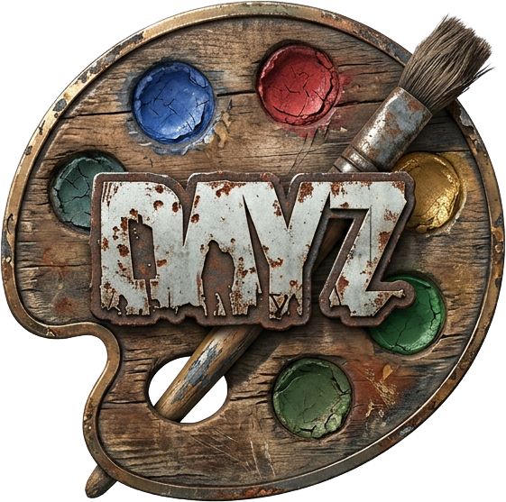

# DayZ ImageSets Visual Editor

<p align="center">
  
</p>

<p align="center">
  <strong>A modern, standalone visual editor for DayZ Enfusion <code>.imageset</code> files and textures (<code>.edds</code> / <code>.png</code>).</strong>
</p>

<p align="center">
  <a href="#features">Features</a> •
  <a href="#installation">Installation</a> •
  <a href="#how-to-use">How to Use</a> •
  <a href="#building-from-source">Building from Source</a> •
  <a href="#dayz-integration">DayZ Integration</a> •
  <a href="#license">License</a>
</p>

---

## 🌟 Overview (ภาพรวม)

In DayZ modding, defining custom UI icons and sprites via Bohemia Interactive's Workbench ImageSet Editor can be tedious, restrictive, or prone to formatting issues. 

**DayZ ImageSets Visual Editor** is built with Rust and `eframe/egui` to provide a blazing-fast, lightweight, and modern alternative for DayZ modders. It allows you to visually inspect textures, drag & draw bounding boxes for sprites, and export standard Enfusion-compatible `.imageset` files with accurate DayZ `{GUID}` preservation.

---

## ✨ Features (คุณสมบัติเด่น)

- 🎨 **Direct `.edds` Texture Support:** Automatically decompresses and loads DayZ `.edds` textures using integrated `edds2png` support.
- 📐 **Visual Bounding Box Manipulation:**
  - Drag to move sprite boxes freely.
  - Interactive corner handles to resize width and height with real-time feedback.
  - Configurable **Snap to Grid** (default 8px) with toggleable grid sizes.
- 🔍 **DayZ GUID & Meta Resolution:**
  - Preserves `{GUID}` paths (e.g. `{534691EE0479871C}Gui/imagesets/dayz_gui.edds`).
  - Automatically scans for corresponding `.edds.meta` files to discover and attach the correct GUID if missing.
- 📋 **Sprite Management:**
  - **Duplicate Box (`Ctrl + D`):** Quick duplication of bounding boxes, flags, and size.
  - **Delete Sprite (`Del` / `Backspace` / `✕`):** Safe deletion with keyboard shortcuts.
  - Card-wide click selection to jump directly to any sprite.
  - Toggle sprite name labels (`[x] Show Names`) on the visual canvas.
- 💻 **Live Enfusion Code Generation:** Instant preview of the generated DayZ `ImageSetClass` hierarchy with one-click **Copy Code**.
- 🚀 **Zero Heavy Dependencies:** Standalone native desktop executable without requiring full Workbench or visual studio installs.

---

## 📥 Installation (การติดตั้งและการดาวน์โหลด)

1. Download the latest release from the [GitHub Releases](https://github.com/GreenDevth/DayZ-ImageSet-Editor/releases) page.
2. Extract the archive into any folder on your computer.
3. Ensure `edds2png.exe` is placed alongside `dayz_imageset_editor.exe` (included by default).
4. Run `dayz_imageset_editor.exe` directly!

---

## 🛠️ How to Use (คู่มือการใช้งานเบื้องต้น)

### 1. Loading Textures
- Click **`Load Texture (EDDS/PNG)`** to open your mod's texture sheet (`.edds`, `.png`, `.tga`, `.jpg`).
- The editor will automatically detect resolution (RefSize) and display it on the interactive pan/zoom canvas.

### 2. Importing Existing `.imageset`
- Click **`Import .imageset`** to open any DayZ imageset file (e.g. `dayz_gui.imageset` or custom mod files).
- The editor parses all `ImageSetDefClass` and `ImageSetGroupClass` items and locates the corresponding texture.

### 3. Canvas Controls & Hotkeys
| Action | Shortcut / Control |
|---|---|
| **Pan Canvas** | Right Mouse Button Drag (or switch to `Pan Mode`) |
| **Zoom Canvas** | Mouse Scroll Wheel (or `+` / `-` buttons) |
| **Reset View** | `Fit / Reset View` button |
| **Draw New Box** | Left Mouse Drag on canvas (in `Draw/Edit Mode`) |
| **Move Box** | Left Mouse Drag inside an existing box |
| **Resize Box** | Left Mouse Drag any of the 4 corner handles |
| **Duplicate Selected** | `Ctrl + D` |
| **Delete Selected** | `Delete` or `Backspace` (when not editing text) |

### 4. Saving
- Click **`Save .imageset`** to output the clean, Enfusion-formatted `.imageset` file ready for packaging into your DayZ mod PBO.

---

## 🧱 Building from Source (การคอมไพล์จากโค้ด)

### Prerequisites
- [Rust & Cargo](https://rustup.rs/) (1.70+ recommended)
- Visual Studio C++ Build Tools (Windows)

### Build Commands
```bash
# Clone the repository
git clone https://github.com/GreenDevth/DayZ-ImageSet-Editor.git
cd DayZ-ImageSet-Editor

# Build release executable
cargo build --release
```
The compiled executable will be located at:
```
target/release/dayz_imageset_editor.exe
```

---

## 🎮 DayZ Integration Example (ตัวอย่างการนำไปใช้ใน Mod)

Once you save your `.imageset` (e.g., `vehicles_icons.imageset`), register it in your mod's `config.cpp`:

```cpp
class CfgPatches
{
    class MyMod_GUI
    {
        units[] = {};
        weapons[] = {};
        requiredVersion = 0.1;
        requiredAddons[] = {"DZ_Data", "DZ_GUI"};
    };
};

class CfgVehicles
{
    // Mod definitions...
};
```

And in your Enforce Script (`.c`):
```c
// โหลดไอคอนจาก ImageSet เข้าสู่ ImageWidget
ImageWidget iconWidget = ImageWidget.Cast(layoutRoot.FindAnyWidget("MyIcon"));
if (iconWidget)
{
    iconWidget.LoadImageFile(0, "set:vehicles_icons image:remote_battery");
}
```

---

## 📄 License
This project is licensed under the [MIT License](LICENSE).

---

<p align="center">
  Developed with ❤️ for the DayZ Modding Community by <strong>GreenDevth</strong>.
</p>
